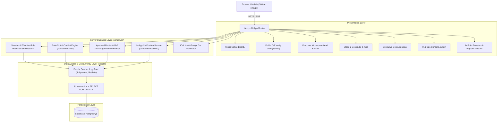
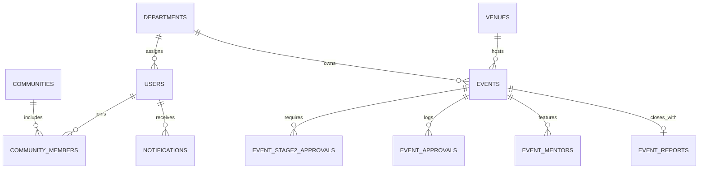

# SaveSlot v1.0.0 — System Design Document

**Product:** SaveSlot — College Event Scheduling, Approval & NAAC/NBA Reporting  
**Institution:** Albertian Institute of Science & Technology (AISAT) *(via `NEXT_PUBLIC_CAMPUS_NAME`)*  
**Version:** `1.0.0` *(Target Design — Planned Rebuild from `v0.3.0` POC)*  
**Status:** Finalized for Implementation  

---

## 1. Design Goals

This document captures the technical design behind SaveSlot `v1.0.0`. Our goal is to replace paper approval slips and ad-hoc event tracking across AISAT while keeping the fast, quiet user experience of the `v0.3.0` POC:

1. **Clean Separation Between IT Setup and Approvals:** Admins configure departments, communities, venues, and user accounts, but cannot approve or reject events. Governance sits strictly with TICs, HODs, and the Principal/VP.
2. **Deterministic Scheduling Without Leaks:** Pending proposals soft-lock venues inside the conflict checker so two teams don't fight over the same hall, while staying invisible on the public notice board until P/VP signs off.
3. **Co-Hosted Events Without Special-Case Spaghetti:** Both single-host and joint/co-hosted events run on the exact same `event_stage2_approvals` table—each participating Department or Community gets one required sign-off row.
4. **Real-World Faculty Role Flexibility:** In a real college, a CSE faculty member (`staff`) is often also the Teacher-in-Charge of a club or the Acting HOD when the regular HOD is away. Permission checks look at both `users.role` and assignment tables (`departments`, `community_members`), so faculty never need duplicate accounts.
5. **Trustworthy Physical Filing:** Reference numbers are generated inside the final approval transaction (zero gaps), approval trails snapshot the signer's name and role at the moment of action, and `/verify/[code]` exposes authenticity without leaking budget or rejection notes.

---

## 2. High-Level System Architecture

---

## 3. Tech Stack

| Layer | Choice | Why |
| :--- | :--- | :--- |
| **Framework** | Next.js `16.4.x` (App Router, Turbopack) | SSR public calendar, fast route handlers, clean layout auth guards |
| **UI & Styling** | React `19.3.x`, Tailwind CSS `v4` | Responsive mobile/desktop UI + `@media print` A4 stylesheets |
| **Database & ORM** | PostgreSQL (Supabase), Drizzle ORM `0.45.x`, `pg` | Type-safe queries + explicit row-level locking (`SELECT FOR UPDATE`) |
| **Dates & Validation** | `date-fns` `v4`, `zod` `v4` | Interval conflict checks, academic year math, strict payload schemas |
| **Icons & QR** | `lucide-react`, lightweight SVG QR generator | Crisp UI icons and print-sharp vector QR codes without heavy PDF libs |

---

## 4. Data Model Overview (`v1.0.0`)

### Key Table Changes from POC (`v0.3.0` $\rightarrow$ `v1.0.0`)

- **`college_settings` *(replaces `campuses`)***: Because each college runs on its own independent host and dedicated database, `v1.0.0` drops `campuses` and all `campus_id` foreign keys in favor of a 1-row `college_settings` config table (`college_name`, `short_code` e.g. `AISAT`, `letterhead_subtitle`, `logo_url`, `academic_year_start_month = 7`, `timezone = 'Asia/Kolkata'`).
- **`departments` *(new)***: Holds department `code` (`CSE`, `ECE`, `EEE`, `AI`, `ME`, `CE`), `hod_user_id`, `acting_hod_user_id`, `is_acting_hod_active`, and audit fields for who toggled Acting HOD mode.
- **`communities` *(updated)***: Adds `scope` (`'internal' | 'external'`) and short `code` (e.g., `GDG`, `IEEE`) for reference numbering.
- **`community_members` *(updated)***: Supports `'lead' | 'tic' | 'member'`, allowing multiple TICs per community and multiple communities per TIC.
- **`users` *(updated)***: Roles expanded to `'admin' | 'principal' | 'vice_principal' | 'hod' | 'tic' | 'staff' | 'lead'`, plus `department_id` and `designation`.
- **`events` *(updated)***: Adds `origin_type` (`'community' | 'department' | 'college'`), `department_id`, `coordinator_id` (optional College closure owner), `reference_number`, `academic_year`, `estimated_budget`, `funding_source`, `is_lead_time_overridden`, `override_reason`, and expanded `status` states.
- **`event_stage2_approvals` *(new)***: Tracks Stage 2 approval **and** post-event report verification for every participating host (primary + co-hosts).
- **`event_approvals` *(new)***: Append-only audit log recording every submission, approval, rejection, override, bump, and report verification with actor name/role snapshots and timestamps.
- **`event_mentors` *(new)***: Stores planned and confirmed mentors/resource persons (`name`, `role_title`, `organization`, `mentor_type: 'internal' | 'external'`).
- **`event_reports` *(new)***: Stores post-event attendance counts, `actual_fund_used`, `funding_source`, NAAC/NBA `summary`, `outcomes`, and `evidence_url`.
- **`event_reference_counters` *(new)***: Atomic sequence table `(academic_year, host_code, last_seq)` so concurrent approvals never collide or skip numbers.
- **`notifications` *(new)***: In-app notifications for approvals, rejections, bumps, Acting HOD changes, and overdue closure reports.

---

## 5. Scheduling, Overrides & Gatekeeping Logic

### 5.1 Venue Overlap Check

A candidate window $[T_s, T_e]$ conflicts with any existing event $[E_s, E_e]$ in the same venue when:

$$\text{Overlap} \iff (T_s < E_e) \land (T_e > E_s) \land \text{status} \in \{\text{'pending\_stage2'}, \text{'pending\_executive'}, \text{'published'}\}$$

- `pending_stage2` and `pending_executive` are **soft reservations** (shown in proposer/approver tools, hidden on `/`).
- `published` is a **hard reservation** (shown everywhere).

### 5.2 Policy Enforcement & Overrides

1. **7-Day Notice Rule:** Enforced for `community` and `department` proposals. Principal/VP can override it after confirming a clear warning modal; the override flag and reason appear on the audit trail and printed dossier.
2. **College Priority Override:** When P/VP schedules a `college` event over existing bookings, the UI shows the colliding events and lets P/VP bump them to `needs_reschedule` in the same transaction, sending in-app notifications to the affected teams.
3. **Immediate Overdue Report Block:** When a `lead` or `staff` user attempts to submit a proposal, the server checks whether they own/coordinate any `published` event whose `end_time < now()` without an `event_reports` record. If any exist, submission is blocked (`403`) with direct links to close those events first. (`principal` and `vice_principal` are exempt.)

---

## 6. Access Matrix & Privacy Boundaries

| Persona | Role / Assignment | Public (`/` & `/verify`) | Propose (`/lead`, `/staff`) | Stage 2 (`/tic`, `/hod`) | Executive (`/principal`) | Reports (`/reports/*`) | Admin (`/admin`) |
| :--- | :--- | :---: | :---: | :---: | :---: | :---: | :---: |
| **Student / Visitor** | *(unauth)* | View & Export | ❌ | ❌ | ❌ | ❌ | ❌ |
| **Lead / Student Coord** | `lead` | View & Export | Assigned Scope | ❌ | ❌ | Own Events | ❌ |
| **Faculty Staff** | `staff` | View & Export | Assigned Dept | *(if TIC / Acting HOD)* | ❌ | Own Events | ❌ |
| **Teacher-in-Charge** | `tic` (or `community_members`) | View & Export | ❌ | Assigned Communities | ❌ | Assigned Communities | ❌ |
| **HOD / Acting HOD** | `hod` (or active `acting_hod`) | View & Export | ❌ | Assigned Dept | ❌ | Assigned Dept | ❌ |
| **Principal / VP** | `principal` / `vice_principal` | View & Export | College Events | ❌ | Final Approve & Override | All Campus | Emergency Acting HOD / Communities |
| **Campus Admin** | `admin` | View & Export | ❌ | ❌ | ❌ | ❌ | IT / Ops Setup Only |

### Privacy on `/verify/[code]`

Scanning the QR code on a printed A4 sheet opens `/verify/[code]`, which intentionally displays only **Reference Number, Title, Dates, Venue, Origin/Hosts, Approval Chain (Names, Roles, Timestamps), and Status**—while hiding funds used, rejection history/reasons, and personal contact details.
